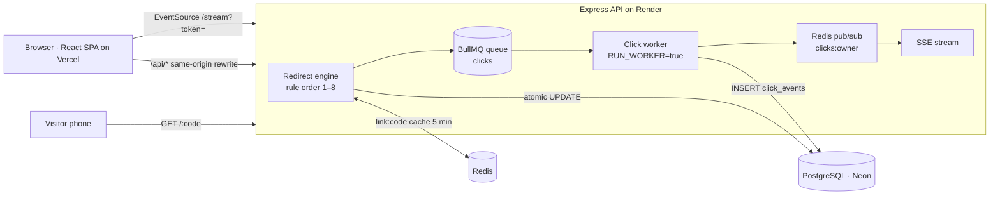

# LinkPulse

**Short links you stay in control of.** URL shortener and analytics platform: a two-step link wizard with live checks,
rules that really change the redirect (expiry, click limit, password, device rules, admin disable), QR codes per poster
location, CSV import, link-in-bio pages, and a live dashboard where bots are kept out of the counts.

Team **Return 0** · Graphic Era Hill University, Haldwani · Tech Geeks Hackathon, Oct 2026 · Round 2 prototype.

> AI use: this prototype was built with an AI coding assistant (Claude Code) from the team's own design and plan.
> Every file must be reviewed and explained by the team before judging. See [docs/PROGRESS.md](docs/PROGRESS.md) → "Before Round 2".

---

## Architecture



- **apps/api** — Node.js + Express + TypeScript, Prisma (schema + migrations) with raw SQL for the atomic limit and analytics.
  Business logic is in plain, tested functions in [`apps/api/src/logic/`](apps/api/src/logic) (no Express, no DB).
- **apps/web** — React + TypeScript + Tailwind (Vite single-page app, React Router, Recharts). No server code.
- **Redis is optional.** If it is missing or down, links are read from Postgres and clicks are written straight to Postgres.

## The redirect engine: rule order

Every visit to `GET /:code` runs these checks in this exact order ([`logic/rules.ts`](apps/api/src/logic/rules.ts), [`redirect/engine.ts`](apps/api/src/redirect/engine.ts)):

| # | Check | If it fails | HTTP |
|---|---|---|---|
| 1 | Link exists (Redis cache, then DB) | "We can’t find this link" page (+ "Did you mean" for close aliases) | 404 |
| 2 | Disabled by admin, or destination domain now blocked | "This link has been turned off" | 410 |
| 3 | Expired (`now > expires_at`, UTC) | Fallback URL if set (302), else "This link has expired" | 302 / 410 |
| 4 | Password set and not unlocked | Password form; wrong tries never counted; 5 wrong → wait 5 min | 401 / 429 |
| 5 | Bot? (user agent + burst > 10 hits / 10 s) | Redirect anyway (previews work), logged as bot, **not counted** | 302 |
| 6 | Under the limit? (one atomic UPDATE) | "All spots are taken" | 410 |
| 7 | Device rule (iOS / Android / desktop, by priority) | No match → main destination | — |
| 8 | Queue the click (async), send the redirect | — | 302 |

**Why this order**
- Disable before expiry, so an admin takedown always wins.
- Password before counting, so wrong tries never use up the limit.
- Bots before the limit, so a WhatsApp preview never takes a real slot.
- Always **302, never 301**: browsers cache 301, so later visits would skip our rules and counts. Responses also send `Cache-Control: no-store`.

**The atomic click limit** (never "read, then add"):
```sql
UPDATE links SET click_count = click_count + 1
WHERE id = $1 AND status = 'active' AND (click_limit IS NULL OR click_count < click_limit)
RETURNING click_count;   -- 1 row → allowed · 0 rows → "Limit reached"
```

**Privacy:** no raw IP is stored. `visitor_hash = sha256(ip + user agent + IST date + HASH_SALT)`; the IP never reaches Redis or Postgres.

## Run it locally

Needs Node 20+ and Docker (for Postgres + Redis).

```bash
npm install
```
```bash
docker compose up -d
```
```bash
cp apps/api/.env.example apps/api/.env
```
Edit `apps/api/.env`: set long random `JWT_SECRET` and `HASH_SALT`, and a `SEED_PASSWORD` (8+ characters) for the demo users.
```bash
npm run db:migrate -w apps/api
```
```bash
npm run db:seed -w apps/api
```
```bash
npm run dev:api
```
```bash
npm run dev:web
```
Open http://localhost:5173 and sign in as `team@linkpulse.test` (or `admin@linkpulse.test`) with your `SEED_PASSWORD`.
Short links work at http://localhost:4000/&lt;code&gt;, for example `/club-join`. The private demo link `innovista26` uses `SEED_LINK_PASSWORD` (defaults to `SEED_PASSWORD`).

### Tests
```bash
docker compose exec postgres createdb -U linkpulse linkpulse_test
```
```bash
npm test
```
API tests use the separate `linkpulse_test` database and Redis DB 1, and refuse to run against a database without "test" in its name.

### Load test (k6 in Docker)
```bash
docker run --rm -v "$PWD/load:/scripts" grafana/k6 run -e BASE=http://host.docker.internal:4000 -e CODE=club-join /scripts/k6-redirect.js
```
Add `-e SCENARIO=limit -e CODE=<a link with limit 100>` for the exact-limit test. Measured results are in [docs/PROGRESS.md](docs/PROGRESS.md).

## Environment variables

`apps/api/.env` (see [`.env.example`](apps/api/.env.example)) — `DATABASE_URL`, `REDIS_URL` (empty = no Redis), `JWT_SECRET`, `HASH_SALT`,
`SHORT_BASE_URL` (public URL of the API, used in short links and QR codes), `WEB_ORIGIN`, `RUN_WORKER`, `TZ_DISPLAY`, `SEED_PASSWORD`,
optional `SEED_LINK_PASSWORD`, `GEOIP_ENABLED=false` (saves memory on tiny hosts).

`apps/web/.env` — `VITE_SHORT_BASE_URL` (same as the API's `SHORT_BASE_URL`), `VITE_API_BASE=/api`. Everything in `VITE_*` is public.

## Deploy

Frontend on **Vercel**, API as a **Docker** image on **Render**, **Neon** Postgres, hosted **Redis** (Upstash or Redis Cloud).
Step-by-step guide with every environment variable, the production seed and a troubleshooting table: **[docs/DEPLOY.md](docs/DEPLOY.md)**.

- API image: [`apps/api/Dockerfile`](apps/api/Dockerfile) (build from the repo root). It runs `prisma migrate deploy` on start, then the API + click worker.
- Render Blueprint: [`render.yaml`](render.yaml) (Docker, free plan, Singapore, health check `/health`).
- Vercel: Root Directory `apps/web`; [`apps/web/vercel.json`](apps/web/vercel.json) rewrites `/api/*` to Render (same-origin cookie) and falls back to `index.html`.
- Neon: `DATABASE_URL` = pooled URL (+ `pgbouncer=true`), `DIRECT_URL` = direct URL for migrations.

## What is where

| Area | Files |
|---|---|
| Rule order, status | `apps/api/src/logic/rules.ts` |
| Codes, alias, URL checks, bots, hash, source, device, alerts, contrast, IST time | `apps/api/src/logic/*.ts` |
| Redirect + password + report | `apps/api/src/redirect/engine.ts`, `apps/api/src/views/visitor.ts` |
| Click queue, worker, alerts job | `apps/api/src/queue/` |
| Live stream | `apps/api/src/sse/` + `apps/web/src/hooks/useLiveClicks.ts` |
| API routes | `apps/api/src/routes/` (profile: `routes/profile.ts`, shared workspaces + invites: `routes/workspaces.ts`) |
| Schema, seed | `apps/api/prisma/` |
| Screens | `apps/web/src/pages/` (one per `LinkPulse-UI/*.html`) |
| Tests | `apps/api/tests/` (unit + edge cases 1–15), `apps/web/src/lib/format.test.ts`, `load/k6-redirect.js` |

## Roadmap
Custom domains · public API with keys · A/B split links · webhooks to Slack/Discord · safe-browsing check · email notifications for workspace invites.

More: [design decisions](docs/design/decisions.md) · [progress log](docs/PROGRESS.md) · [5-minute demo script](docs/DEMO.md).
