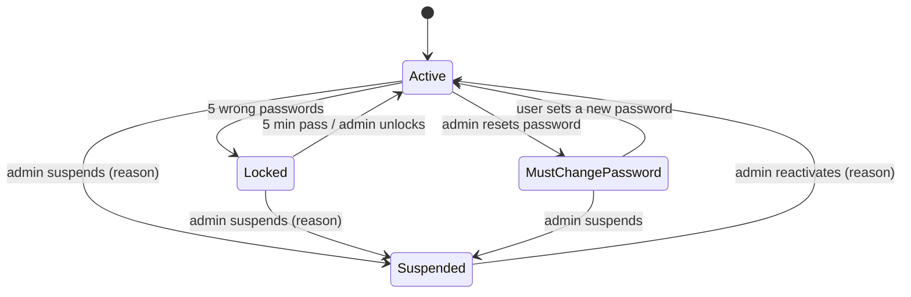

# Admin user management — design note

**Goal:** a platform admin can **search for any user, open them, and handle their account and links from one place**:
suspend / reactivate, unlock, sign out everywhere, reset the password, and edit any of their links. Every action needs a
reason, is written to the audit log, and the owner can see it.

**Status:** approved and built (milestones 1–4). Not built: F11 (Could), disabling all of a user's links in one action.

## Today (what changes)
| Area | Admin can do today | Gap |
|---|---|---|
| Links | Open/edit a link **if they know its id** (`loadOwnedLink` lets `role = admin` through); disable/restore flagged links | No way to *find* a user's links; edits carry no reason |
| Accounts | Nothing | No user list, no search, no account actions |
| Audit | Read the platform audit log | Rows point to a link, never to the **user** an action was about |

Sessions are already re-loaded from the DB on every request (`loadUser` + `tokenVersion`), so account actions take effect
on the user's very next request with no new infrastructure.

## Requirements
**Who:** the platform admin(s) of a hackathon/college deployment (1–3 people). **Today's workaround:** editing rows in the
Neon console, with no audit trail. **Success:** every task below is done from the UI in < 1 minute, and 100 % of admin
actions are in the audit log with a reason.

| # | Story | Priority |
|---|---|---|
| F1 | Search users by name or email; filter by status (active / suspended / locked); paginated | Must |
| F2 | Open a user: profile, status, workspaces, their links, account history | Must |
| F3 | Suspend (with reason) → cannot sign in, every session ends at once; reactivate | Must |
| F4 | Unlock an account locked after 5 wrong passwords | Must |
| F5 | Sign the user out on every device | Must |
| F6 | Reset password → one-time temporary password, user must set a new one at next sign-in | Must |
| F7 | Open any of the user's links and edit everything an owner can (Edit, device rules, Link life); reason required | Must |
| F8 | Owner sees why: link history shows "Platform admin · reason"; suspended users see the reason at sign-in | Must |
| F9 | Profile page shows "Account notices" (admin actions on your account) | Should |
| F10 | `last_login_at` shown in the user list | Should |
| F11 | Disable all of a user's links in one action | Could |
| — | Change roles, impersonate ("log in as"), hard-delete links or users | Won't (decided) |

**Non-functional**
- Every admin mutation writes an audit row with actor, subject user, old → new value and reason — enforced in tests.
- Suspend / sign-out / reset take effect on the user's **next request** (no cached sessions to wait out).
- User search p95 < 300 ms with 10 k users (`ILIKE` on name/email, `LIMIT 20`).
- Temporary password: 14 chars from `crypto.randomInt` over a 57-symbol alphabet without look-alikes (~82 bits); stored
  only as a bcrypt hash; never logged, never in the audit log; shown to the admin once. "One-time" means shown once and
  replaced at the first change: it works until the user sets their own password or 24 h pass, whichever is first (also
  enforced for a session that signed in with it in time).
- A `role = user` account gets 403 on every new `/api/admin/*` route.

**Capacity:** prototype scale: < 1 k users, < 50 k links, a few admin actions a day. This is the existing single-API tier.
**No new services** (no queue, cache or search engine). Scale-up path: a `pg_trgm` GIN index on `users(email, name)` if search
slows past ~100 k users.

## Account lifecycle

Status is **derived** from columns (like link status): `suspended_at` → Suspended; else `locked_until > now` → Locked; else
`must_change_password` → Password reset pending; else Active.

## Who can do what
| Action | Admin on a `user` account | Admin on another admin | Admin on self | User |
|---|---|---|---|---|
| Search / view users and their links | ✅ | ✅ (view only) | ✅ | ❌ 403 |
| Suspend, reactivate, unlock, sign out, reset password | ✅ reason required | ❌ 403 | ❌ 403 | ❌ |
| Edit a link in a workspace the admin is not in | ✅ reason required | ✅ reason required | — | only own workspaces |

## Data model (one additive migration)
`users`:
| Column | Type | Why |
|---|---|---|
| `suspended_at` | timestamptz null | Suspended when set |
| `suspended_reason` | text null | Shown to the user at sign-in |
| `must_change_password` | boolean default false | Forces the "set a new password" screen |
| `temp_password_expires_at` | timestamptz null | Temporary password stops working after 24 h |
| `last_login_at` | timestamptz null | User list (F10) |

`audit_log`: add `subject_user_id uuid null → users(id)` plus index `(subject_user_id, created_at)`. This feeds the user page's
account history and the owner's "Account notices". No data is rewritten; existing rows keep `NULL`.

## API
All new routes are under `/api/admin` (`requireUser` + `requireAdmin`, as today). Reasons are 5–300 chars.

| Method & path | Body / query | Does |
|---|---|---|
| `GET /admin/users` | `q, status=all\|active\|suspended\|locked, page, pageSize≤50` | List + status counts; each row: name, email, role, status, links, workspaces, joined, last sign-in |
| `GET /admin/users/:id` | — | Profile, status, workspaces (name, role, members), link counts, last 50 account audit rows |
| `GET /admin/users/:id/links` | `q, status, page` | Links the user created (`owner_id`), across all their workspaces, with a workspace column |
| `POST /admin/users/:id/suspend` | `{ reason }` | `suspended_at`, reason, `token_version + 1` (ends sessions) |
| `POST /admin/users/:id/reactivate` | `{ reason }` | Clears suspension |
| `POST /admin/users/:id/unlock` | `{ reason }` | `failed_logins = 0`, `locked_until = null` |
| `POST /admin/users/:id/sign-out` | `{ reason }` | `token_version + 1` |
| `POST /admin/users/:id/reset-password` | `{ reason }` | New temp password hash, `must_change_password`, 24 h expiry, `token_version + 1`; response `{ temporaryPassword }` once, `Cache-Control: no-store` |

Changed routes:
- `POST /auth/login`: after a **correct** password, a suspended user gets `403 ACCOUNT_SUSPENDED` with the reason. An
  expired temporary password gets `401 TEMP_PASSWORD_EXPIRED`. Sets `last_login_at`.
- `requireUser`: rejects suspended users. If `must_change_password` is set, it returns `403 PASSWORD_CHANGE_REQUIRED` on
  everything except `GET /auth/me`, `POST /auth/logout` and `POST /me/password`.
- `POST /me/password`: the temporary password counts as the current password; success clears the flag and the expiry.
- `PATCH /links/:id` and `POST /links/:id/state`: optional `reason`. **Required** (`400 REASON_REQUIRED`) when the caller is an
  admin who is not a member of the link's workspace. Stored on each audit row; link history already shows
  "Platform admin" and the reason.

## Key decisions
1. **No impersonation; admin acts from admin screens.** Every audit row then clearly says *the admin* did it. "Log in as"
   would need a second session type, a banner, and careful rules on what the admin may do as the user, which is a lot of
   security surface for a prototype.
2. **The suspended check runs after the password is verified.** If it ran first, anyone who knew an email could learn that
   the account exists and read the suspension reason. Checking after keeps the existing "same message for unknown
   emails" guarantee.
3. **Temporary password instead of a reset email.** There is no email service, and adding one is new infrastructure (CLAUDE.md:
   ask first). It's shown once, valid 24 h and forces a change, which limits the damage if it leaks on a shared screen.
4. **Admins cannot act on other admins or themselves.** There is no role hierarchy, so two admins could otherwise lock each
   other out, or the last admin could suspend themself. Admin accounts stay managed by seed/DB, as role changes are out
   of scope.
5. **Suspending does not stop the user's links.** Links are shared (posters, QR codes) and a suspension is about the
   account. To stop links, the admin disables them (existing flow) or uses F11.
6. **"Their links" means links they created (`owner_id`).** In shared workspaces a user also sees teammates' links, but
   those belong to the teammates. The workspace column and the Workspaces tab show the shared context.
7. **Admins can view, not create, QR codes on other people's links.** Making posters is the workspace's job; an
   admin's changes to someone else's link go through Edit / Link life with a reason. (`POST /links/:id/qr` → 403
   `NOT_IN_WORKSPACE` for non-members, admins included.)
8. **Admin link edits name the link's creator as the audit subject.** One audit row then feeds the owner's link history,
   their Account notices and the admin's page for that user. In a shared workspace the creator is told, not every member.
9. **No admin workspace membership.** As in `workspaces.md`, admins see users' data through admin routes and the
   admin-allowed link routes, never by joining workspaces. Live visit streaming stays per workspace; an admin viewing
   someone else's link sees fresh numbers on reload.

## Frontend
- **Admin → Users** (`/admin/users`): search box (debounced), status chips with counts, table, pagination. The search term
  stays in component state, not in the URL, so emails don't end up in browser history.
- **User page** (`/admin/users/:id`): header with name, email, status badge, joined and last sign-in; action buttons
  (Suspend/Reactivate, Unlock only when locked, Sign out everywhere, Reset password). Each opens a reason dialog (same
  pattern as `DisableDialog`). Reset shows the temporary password once, with Copy and a "won't be shown again" warning.
  Tabs: **Links** (search + status filter → opens the normal link page), **Workspaces**, **Account history**.
- **Link page as admin:** an "Admin view: changes are shown to the owner" banner; Edit and Link life dialogs get a
  required "Reason (shown to the owner)" field.
- **Users:** sign-in shows the suspension reason. A forced "Set a new password" screen appears after a reset. Profile →
  Account notices (F9).

## Milestones (vertical slices, each with tests + secure-code-review)
1. **Find a user:** migration, `GET /admin/users`, `/:id`, `/:id/links`; Users page and read-only user page.
2. **Account actions:** suspend / reactivate / unlock / sign out with reasons; login and `requireUser` changes; the
   user sees the suspension reason.
3. **Reset password:** temporary password, forced change screen, expiry.
4. **Admin edits links:** `reason` on PATCH and Link life, the banner and reason fields; owner history shows it; Account
   notices (Should).

## Tests
- Every new admin route: 401 signed out, 403 for `role = user`, 403 against an admin or self.
- Suspend: the user's existing session gets 401 on the next request; login with the right password gets
  `ACCOUNT_SUSPENDED` + reason; the wrong password still gets the generic message; links keep redirecting.
- Reset: the old password fails; signing in with the temporary password allows only `/me/password` until it's changed; it
  expires after 24 h (at sign-in and for a session already open); it never appears in the audit log or API logs.
- Search: name/email match, status filters, pagination, counts.
- Admin link edit without a reason → 400; with one → the owner's history shows "Platform admin" + reason.
- Every action writes exactly one audit row with `subject_user_id` set.

## Risks
| Risk | Mitigation |
|---|---|
| A stolen admin account controls every user | Reasons + full audit; no admin-on-admin actions; temp passwords shown once and expiring. Later: re-enter the admin password before sensitive actions (Could) |
| Temporary password leaks (screen share, chat) | 24 h expiry, forced change at first use, sessions ended at reset |
| A live-visits stream opened before a suspension stays open until it disconnects (the stream token is checked once, when it opens; new tokens need a valid session) | Low impact: it only carries click events for the user's own workspace. Fix later by closing a user's streams on suspend |
| Restore on the Abuse monitor (an existing admin action) does not ask for a reason, unlike everything added here | Small follow-up: add the reason dialog to Restore |
| The admin forgets a user's links still work after suspension | The user page shows "N active links" next to Suspend, with a link to disable them (F11) |
| Search exposes personal data | Admin-only routes; the search term stays out of the browser URL and history. The API request still carries it as `?q=`, so the host's request logs (Render) may record it. Move to POST if that matters |
